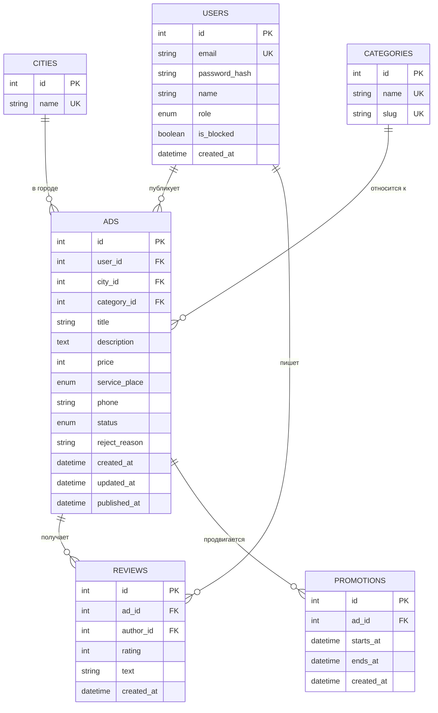
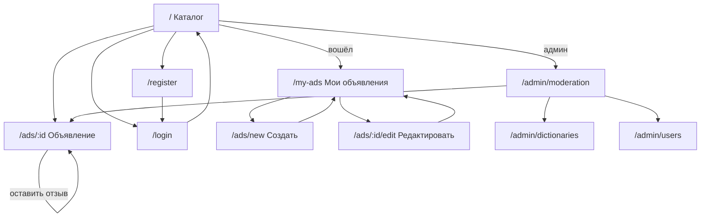

# EasyKey — архитектура проекта

Площадка объявлений о услугах по замкам: вскрытие, установка, ремонт, сигнализации. Мастер публикует объявление с номером телефона, клиент находит его и звонит.

**Стек:** React (Vite) + Node.js + Express + PostgreSQL + Prisma.

## 0. Что мы решили и какие допущения сделали

Из твоих ответов:

- Объявления публикуют сами мастера, после регистрации.
- Каждое объявление проверяет администратор, и только потом оно появляется на сайте.
- Объявление привязано к городу и категории.
- Цена только фиксированная, телефон один.
- Отзывы нужны.
- Размещение бесплатное, но потом будет платное продвижение.

Допущения (если что-то не так, скажи, и поправим):

1. Городов несколько, список ведёт администратор.
2. Отдельных ролей «мастер» и «клиент» нет. Есть один тип «пользователь»: он может и публиковать объявления, и оставлять отзывы. Один человек вполне может быть и клиентом, и мастером.
3. Гость (без регистрации) может смотреть объявления и звонить, но не может публиковать и писать отзывы.
4. Фотографий в первой версии нет (ты их не упоминал), но архитектура готова их добавить (раздел 10).
5. Цена хранится целым числом в тенге.
6. Срок сдачи неизвестен. MVP ниже рассчитан примерно на 4–6 недель неспешной работы.

> **Почему так (про одну роль «пользователь»):** если сделать две отдельные роли «мастер» и «клиент», придётся два раза регистрироваться тому, кто и ремонтирует, и сам ищет мастера. Одна роль проще, а права на действия проверяются по владельцу объявления.

---

## 1. Пользователи и роли

| Роль | Кто это | Что может |
|---|---|---|
| **Гость** | Любой посетитель без входа | Смотреть каталог, фильтровать по городу и категории, открывать объявление, видеть телефон и отзывы, регистрироваться, входить |
| **Пользователь** | Зарегистрированный человек (мастер или клиент) | Всё, что гость, плюс: создавать, редактировать и архивировать **свои** объявления; видеть статус проверки; оставлять отзывы на **чужие** объявления; удалять **свои** отзывы |
| **Администратор** | Владелец сайта | Всё, что пользователь, плюс: одобрять и отклонять объявления; удалять любые объявления и отзывы; блокировать пользователей; управлять городами и категориями |

> **Почему так:** роль хранится в базе в поле `role`, а не «зашита» в код. Если хранить список админов в коде, то для добавления второго админа придётся менять код и выкладывать сайт заново.

---

## 2. MVP (минимальная первая версия)

### Что входит (8 функций)

1. Регистрация и вход (email + пароль).
2. Каталог объявлений с фильтрами по городу и категории и постраничным показом.
3. Страница объявления: описание, цена, место работы (выезд / у мастера), телефон, отзывы.
4. Создание объявления пользователем (уходит на проверку).
5. «Мои объявления»: статус (на проверке / опубликовано / отклонено), редактирование, архивация.
6. Модерация: администратор видит очередь, одобряет или отклоняет с причиной.
7. Отзывы: оценка 1–5 и текст, средний рейтинг в каталоге.
8. Админ-управление городами и категориями.

### Что НЕ входит и почему

| Не входит | Почему |
|---|---|
| Платное продвижение | Нужна оплата (внешний платёжный сервис), это отдельный большой кусок работы. Но **таблицу под него мы продумываем сейчас** (раздел 5) |
| Фотографии | Нужно хранилище файлов и их проверка. Без фото сайт уже работает |
| Подтверждение email, сброс пароля | Нужна отправка писем (почтовый сервис). Для MVP не критично |
| Чат на сайте | Связь идёт по телефону, чат дублировал бы это |
| Избранное, жалобы | Приятно иметь, но сайт без них полноценен |
| Карта и районы | Достаточно города. Районы усложняют форму и фильтры |
| Мобильное приложение | Сайт адаптивный (CSS), этого хватает |

> **Почему так:** MVP нужен, чтобы быстро получить работающий сайт и защитить его. Каждая «лишняя» функция увеличивает шанс, что к сроку не будет готово ничего целиком.

---

## 3. Пользовательские истории

| № | История | MVP? |
|---|---|---|
| US-1 | Как **гость**, я хочу видеть список объявлений своего города, чтобы найти мастера рядом | ✅ |
| US-2 | Как **гость**, я хочу фильтровать объявления по категории услуги, чтобы видеть только нужное (например, «вскрытие замков») | ✅ |
| US-3 | Как **гость**, я хочу открыть объявление и увидеть цену, описание, телефон и отзывы, чтобы решить, звонить или нет | ✅ |
| US-4 | Как **гость**, я хочу зарегистрироваться, чтобы публиковать объявления и писать отзывы | ✅ |
| US-5 | Как **пользователь**, я хочу войти в аккаунт, чтобы управлять своими объявлениями | ✅ |
| US-6 | Как **пользователь (мастер)**, я хочу создать объявление с категорией, заголовком, описанием, ценой, телефоном и местом работы, чтобы клиенты меня нашли | ✅ |
| US-7 | Как **пользователь (мастер)**, я хочу видеть статус своих объявлений и причину отказа, чтобы исправить и отправить заново | ✅ |
| US-8 | Как **пользователь (мастер)**, я хочу редактировать и архивировать своё объявление, чтобы цена и данные были актуальны | ✅ |
| US-9 | Как **пользователь (клиент)**, я хочу оставить оценку и отзыв мастеру, чтобы помочь другим выбрать | ✅ |
| US-10 | Как **пользователь**, я хочу удалить свой отзыв, чтобы исправить ошибку | ✅ |
| US-11 | Как **администратор**, я хочу видеть очередь объявлений на проверке, чтобы одобрять или отклонять их | ✅ |
| US-12 | Как **администратор**, я хочу удалять любые отзывы и объявления, чтобы бороться со спамом | ✅ |
| US-13 | Как **администратор**, я хочу добавлять города и категории, чтобы расширять сайт без программиста | ✅ |
| US-14 | Как **администратор**, я хочу блокировать пользователей-нарушителей, чтобы они не публиковали объявления | ✅ (простой вариант: флаг в базе) |
| US-15 | Как **мастер**, я хочу оплатить продвижение объявления, чтобы оно показывалось выше в списке | ❌ (после MVP) |

---

## 4. Бизнес-правила (сервер проверяет всегда)

Общий принцип: **браузер можно обойти.** Любой человек может открыть инструменты разработчика или отправить запрос программой (например, Postman) и обойти любую проверку на странице. Поэтому проверки в React нужны только для удобства (показать ошибку сразу), а настоящая защита живёт на сервере.

| № | Правило | Почему нельзя проверять только в браузере |
|---|---|---|
| BR-1 | Новое объявление всегда получает статус «на проверке», что бы ни прислал клиент | Иначе хитрый пользователь пришлёт `status: "APPROVED"` и обойдёт модерацию |
| BR-2 | Гости и посетители видят только объявления со статусом «опубликовано» | Иначе по прямой ссылке или запросу можно увидеть ещё не проверенные (возможно, мошеннические) объявления |
| BR-3 | Пользователь может редактировать, архивировать и удалять только **свои** объявления | Подменив номер объявления в запросе, можно было бы менять чужие |
| BR-4 | Если пользователь отредактировал опубликованное объявление, оно снова уходит на проверку | Иначе можно получить одобрение на «нормальный» текст, а потом заменить его на спам |
| BR-5 | Одобрять, отклонять объявления и управлять городами/категориями может только администратор | Кнопку «Одобрить» можно просто показать себе в браузере. Сервер обязан проверить роль |
| BR-6 | При отклонении администратор обязан указать причину | Без причины мастер не поймёт, что исправлять |
| BR-7 | Один пользователь может оставить на одно объявление только один отзыв | Иначе накрутка: один человек пишет 50 отзывов |
| BR-8 | Нельзя оставлять отзыв на своё объявление | Иначе мастер сам себе поставит пятёрки |
| BR-9 | Отзывы можно оставлять только на опубликованные объявления, оценка строго от 1 до 5 | Запрос можно собрать вручную с оценкой 100 или `-5` |
| BR-10 | Телефон: один на объявление, формат проверяется (допустимые символы и длина) | Без проверки в базу попадёт мусор или опасный текст |
| BR-11 | Цена — целое число ≥ 0, город и категория обязаны существовать | Иначе в базе появятся объявления без города или с «ценой» в виде текста |
| BR-12 | Заблокированный пользователь не может входить и публиковать | Блокировку нельзя «спрятать» в браузере: пользователь просто пришлёт запрос напрямую |
| BR-13 | Пароль хранится только в виде хэша, email уникален | Если проверять уникальность только в React, два человека одновременно зарегистрируют один email |
| BR-14 | Лимит: не более N (например, 10) активных объявлений у одного пользователя | Защита от спама. В браузере лимит обходится запросом напрямую |

---

## 5. База данных (PostgreSQL + Prisma)

### 5.1 Таблицы

**users** — пользователи

| Поле | Тип | Примечание |
|---|---|---|
| id | Int, PK, autoincrement | |
| email | String, unique | Для входа |
| password_hash | String | Хэш, не пароль |
| name | String(60) | Имя (показывается в отзывах и объявлениях) |
| role | Enum: USER, ADMIN | По умолчанию USER |
| is_blocked | Boolean | По умолчанию false |
| created_at | DateTime | |

**cities** — города

| Поле | Тип | Примечание |
|---|---|---|
| id | Int, PK | |
| name | String(80), unique | |

**categories** — виды услуг

| Поле | Тип | Примечание |
|---|---|---|
| id | Int, PK | |
| name | String(80), unique | Например: «Вскрытие замков» |
| slug | String(80), unique | Для красивого адреса, например `vskrytie-zamkov` |

**ads** — объявления

| Поле | Тип | Примечание |
|---|---|---|
| id | Int, PK | |
| user_id | Int, FK → users.id | Автор |
| city_id | Int, FK → cities.id | |
| category_id | Int, FK → categories.id | |
| title | String(120) | |
| description | Text | |
| price | Int | Цена в тенге, фиксированная |
| service_place | Enum: VISIT, AT_MASTER, BOTH | Выезд к клиенту / у мастера / оба варианта |
| phone | String(20) | Один номер |
| status | Enum: PENDING, APPROVED, REJECTED, ARCHIVED | По умолчанию PENDING |
| reject_reason | String, nullable | Заполняется при отклонении |
| created_at | DateTime | |
| updated_at | DateTime | |
| published_at | DateTime, nullable | Когда одобрено |

**reviews** — отзывы

| Поле | Тип | Примечание |
|---|---|---|
| id | Int, PK | |
| ad_id | Int, FK → ads.id | На что отзыв |
| author_id | Int, FK → users.id | Кто написал |
| rating | Int | 1–5 |
| text | String(1000) | |
| created_at | DateTime | |
| | **unique (ad_id, author_id)** | Один отзыв на объявление от человека |

**promotions** — продвижение (создаём таблицу заранее, в MVP она пустая)

| Поле | Тип | Примечание |
|---|---|---|
| id | Int, PK | |
| ad_id | Int, FK → ads.id | |
| starts_at | DateTime | |
| ends_at | DateTime | |
| created_at | DateTime | |

### 5.2 Связи

- **users → ads:** один-ко-многим (у пользователя много объявлений, у объявления один автор).
- **cities → ads:** один-ко-многим.
- **categories → ads:** один-ко-многим.
- **ads → reviews:** один-ко-многим.
- **users → reviews:** один-ко-многим (пользователь пишет много отзывов).
- **ads → promotions:** один-ко-многим (одно объявление можно продвигать много раз).
- **users ↔ ads через reviews:** фактически связь «многие-ко-многим» (много пользователей оценивают много объявлений). Таблица `reviews` — это «связующая» таблица, у которой есть свои данные (оценка и текст).

### 5.3 ER-диаграмма



### 5.4 Проверка: дублирование и расширяемость

**Дублирования нет:**

- Название города и категории хранятся один раз, в объявлении только ссылка (`city_id`, `category_id`). Если переименовать «Алматы», оно изменится везде сразу.
- **Средний рейтинг объявления не хранится в таблице.** Он считается из `reviews`. Если хранить его в `ads`, при удалении отзыва легко забыть пересчитать, и рейтинг будет врать. Если сайт вырастет и подсчёт станет медленным, можно добавить сохранённое значение позже.
- Имя автора в объявлении не копируется, берётся из `users`.

**Новые функции не сломают старые таблицы:**

- Фото → новая таблица `ad_images`, таблица `ads` не меняется.
- Продвижение → таблица `promotions` уже есть.
- Избранное → новая таблица `favorites`.
- Районы → новая таблица `districts` и необязательное поле в `ads`.

> **Почему так (про `promotions` отдельной таблицей):** если сделать в `ads` поле «продвигается: да/нет», то нельзя хранить срок, нельзя видеть историю («когда и сколько раз платил») и придётся вручную выключать флаг по таймеру. Отдельная таблица с датами решает всё сразу.

> **Почему так (про `status` в одной таблице `ads`):** если «архивные» и «отклонённые» вынести в другие таблицы, при каждом переходе объявление придётся копировать туда-сюда, и легко потерять данные.

---

## 6. API

Общие правила:

- Адреса начинаются с `/api`.
- Ответы в формате JSON.
- Ошибки: `{ "error": "Понятный текст" }` + подходящий код (400 — неверные данные, 401 — не вошёл, 403 — нет прав, 404 — не найдено).
- Для защищённых запросов фронтенд присылает заголовок `Authorization: Bearer <токен>`.

### 6.1 Таблица эндпоинтов

| Метод | Адрес | Что делает | Доступ | История |
|---|---|---|---|---|
| POST | `/api/auth/register` | Регистрация | Гость | US-4 |
| POST | `/api/auth/login` | Вход, возвращает токен | Гость | US-5 |
| GET | `/api/auth/me` | Данные текущего пользователя | Пользователь, Админ | US-5 |
| GET | `/api/cities` | Список городов | Все | US-1, US-6 |
| GET | `/api/categories` | Список категорий | Все | US-2, US-6 |
| GET | `/api/ads` | Каталог опубликованных объявлений (фильтры: `cityId`, `categoryId`, `page`) | Все | US-1, US-2 |
| GET | `/api/ads/:id` | Одно опубликованное объявление | Все | US-3 |
| POST | `/api/ads` | Создать объявление (статус PENDING) | Пользователь | US-6 |
| GET | `/api/ads/my` | Мои объявления со статусами | Пользователь | US-7 |
| PATCH | `/api/ads/:id` | Изменить своё объявление (уходит на повторную проверку) | Владелец | US-8 |
| PATCH | `/api/ads/:id/archive` | Архивировать своё объявление | Владелец | US-8 |
| GET | `/api/ads/:id/reviews` | Отзывы объявления | Все | US-3 |
| POST | `/api/ads/:id/reviews` | Оставить отзыв | Пользователь (не автор) | US-9 |
| DELETE | `/api/reviews/:id` | Удалить отзыв | Автор отзыва или Админ | US-10, US-12 |
| GET | `/api/admin/ads?status=PENDING` | Очередь на проверку | Админ | US-11 |
| PATCH | `/api/admin/ads/:id/approve` | Одобрить | Админ | US-11 |
| PATCH | `/api/admin/ads/:id/reject` | Отклонить с причиной | Админ | US-11 |
| DELETE | `/api/admin/ads/:id` | Удалить любое объявление | Админ | US-12 |
| POST | `/api/admin/cities` | Добавить город | Админ | US-13 |
| POST | `/api/admin/categories` | Добавить категорию | Админ | US-13 |
| PATCH | `/api/admin/users/:id/block` | Заблокировать или разблокировать | Админ | US-14 |

> **Почему так (`/admin/...` отдельно):** все админские адреса начинаются одинаково, поэтому защиту «только админ» можно повесить на всю группу сразу. Если раскидать по разным местам, одну проверку обязательно забудешь.
>
> **Почему так (`/ads/my` до `/ads/:id`):** в Express порядок маршрутов важен. Если `/:id` стоит первым, слово `my` будет принято за номер объявления.

### 6.2 Примеры запросов и ответов

**Регистрация** `POST /api/auth/register` (US-4)

Запрос:
```json
{ "email": "master@mail.com", "password": "MyPass123", "name": "Ержан" }
```
Ответ `201`:
```json
{ "id": 7, "email": "master@mail.com", "name": "Ержан", "role": "USER" }
```

**Вход** `POST /api/auth/login` (US-5)

Запрос:
```json
{ "email": "master@mail.com", "password": "MyPass123" }
```
Ответ `200`:
```json
{ "token": "eyJhbGciOi...", "user": { "id": 7, "name": "Ержан", "role": "USER" } }
```

**Каталог** `GET /api/ads?cityId=1&categoryId=2&page=1` (US-1, US-2)

Ответ `200`:
```json
{
  "items": [
    {
      "id": 15,
      "title": "Вскрытие замков 24/7",
      "price": 8000,
      "servicePlace": "VISIT",
      "city": "Алматы",
      "category": "Вскрытие замков",
      "averageRating": 4.6,
      "reviewsCount": 12
    }
  ],
  "page": 1,
  "totalPages": 3
}
```

**Одно объявление** `GET /api/ads/15` (US-3)

Ответ `200`:
```json
{
  "id": 15,
  "title": "Вскрытие замков 24/7",
  "description": "Открою дверь без повреждений. Опыт 8 лет.",
  "price": 8000,
  "servicePlace": "VISIT",
  "phone": "+77001234567",
  "city": "Алматы",
  "category": "Вскрытие замков",
  "author": { "name": "Ержан" },
  "averageRating": 4.6,
  "reviewsCount": 12
}
```
Если объявление не опубликовано или не существует: `404 { "error": "Объявление не найдено" }`.

**Создать объявление** `POST /api/ads` (US-6)

Запрос:
```json
{
  "title": "Установка замков",
  "description": "Врезка и замена замков, гарантия 1 год",
  "price": 12000,
  "servicePlace": "BOTH",
  "phone": "+77001234567",
  "cityId": 1,
  "categoryId": 3
}
```
Ответ `201`:
```json
{ "id": 21, "status": "PENDING", "message": "Объявление отправлено на проверку" }
```

**Мои объявления** `GET /api/ads/my` (US-7)

Ответ `200`:
```json
[
  { "id": 21, "title": "Установка замков", "status": "PENDING", "rejectReason": null },
  { "id": 18, "title": "Ремонт сейфов", "status": "REJECTED", "rejectReason": "Не указано описание услуги" }
]
```

**Отзыв** `POST /api/ads/15/reviews` (US-9)

Запрос:
```json
{ "rating": 5, "text": "Приехал за 20 минут, всё аккуратно" }
```
Ответ `201`:
```json
{ "id": 40, "rating": 5, "text": "Приехал за 20 минут, всё аккуратно", "author": "Асель" }
```
Ошибки: `403` (своё объявление), `409` (уже оставлял отзыв), `400` (оценка вне 1–5).

**Отклонить** `PATCH /api/admin/ads/21/reject` (US-11)

Запрос:
```json
{ "reason": "Не указан номер телефона в нужном формате" }
```
Ответ `200`:
```json
{ "id": 21, "status": "REJECTED", "rejectReason": "Не указан номер телефона в нужном формате" }
```

---

## 7. Страницы

### 7.1 Список страниц

| Страница | Адрес | Кто видит |
|---|---|---|
| Главная / каталог с фильтрами | `/` | Все |
| Страница объявления | `/ads/:id` | Все |
| Вход | `/login` | Гость |
| Регистрация | `/register` | Гость |
| Создать объявление | `/ads/new` | Пользователь |
| Мои объявления | `/my-ads` | Пользователь |
| Редактировать объявление | `/ads/:id/edit` | Владелец |
| Модерация (очередь) | `/admin/moderation` | Админ |
| Города и категории | `/admin/dictionaries` | Админ |
| Пользователи | `/admin/users` | Админ |
| Страница «Нет доступа» / «404» | `/403`, `*` | Все |

### 7.2 Карта переходов



> **Почему так (скрывать страницы в React недостаточно):** защита страницы в React (например, «если не админ, показать 403») только удобство. Сам запрос данных всё равно защищён на сервере (раздел 9). Без этого «закрытая» страница показывает пустой экран, но данные можно запросить напрямую.

---

## 8. Структура папок

```
easykey/
├── docs/
│   └── architecture.md
├── client/                      # React (Vite)
│   ├── src/
│   │   ├── pages/               # Страницы: Home, AdPage, Login, MyAds, admin/...
│   │   ├── components/          # Мелкие части: AdCard, ReviewForm, Navbar
│   │   ├── api/                 # Функции запросов к серверу (один файл — один раздел API)
│   │   ├── context/             # Хранение «кто вошёл» (AuthContext)
│   │   ├── routes/              # Маршруты и защита (PrivateRoute, AdminRoute)
│   │   └── main.jsx
│   └── package.json
└── server/
    ├── prisma/
    │   ├── schema.prisma        # Описание таблиц
    │   └── migrations/          # История изменений базы
    ├── src/
    │   ├── routes/              # Какой адрес — какой контроллер
    │   ├── controllers/         # Принять запрос, вернуть ответ
    │   ├── services/            # Вся логика и бизнес-правила
    │   ├── database/            # Подключение Prisma (один общий клиент)
    │   ├── middleware/          # Проверка токена, проверка роли, обработка ошибок
    │   ├── validators/          # Проверка входящих данных
    │   └── app.js
    ├── .env                     # Секреты (не в git!)
    ├── .env.example             # Образец без секретов (в git)
    └── package.json
```

### Слои сервера (путь запроса: routes → controllers → services → database)

| Слой | За что отвечает (одной строкой) |
|---|---|
| **routes** | «Регистратура»: смотрит на адрес и метод и направляет к нужному контроллеру |
| **controllers** | «Приёмщик»: берёт данные из запроса, вызывает сервис, отправляет ответ и код (200, 404 и т.д.) |
| **services** | «Мозг»: здесь бизнес-правила (раздел 4), всё, что решает «можно или нельзя» |
| **database** | «Склад»: только общение с PostgreSQL через Prisma |

> **Почему так (разделение на слои):** если всё писать в одном файле, то правило вроде «нельзя отзыв на своё объявление» придётся копировать в каждое место, где это нужно, и однажды забыть. Если оно живёт в `services`, то работает одинаково для любого запроса, и его можно менять в одном месте.

---

## 9. Безопасность

### Пароли

- В базе хранится **хэш** (необратимая «мясорубка» от пароля), а не сам пароль. Используется библиотека `bcrypt`.
- При входе сервер хэширует введённый пароль и сравнивает хэши.
- Минимальная длина пароля 8 символов (проверяется на сервере).

> **Почему так:** если базу украдут и пароли лежат открыто, злоумышленник войдёт в аккаунты, а люди часто используют один пароль везде. Хэш из `bcrypt` подобрать очень дорого.

### Вход (JWT)

JWT (JSON Web Token) — это «электронный пропуск»: строка, в которой записано, кто ты (id и роль), и стоит подпись сервера.

1. Пользователь отправляет email и пароль на `/api/auth/login`.
2. Сервер проверяет пароль и выдаёт токен со сроком жизни (например, 7 дней).
3. React сохраняет токен и добавляет его в заголовок `Authorization` к каждому запросу.
4. Сервер проверяет подпись и срок. Если всё верно, понимает, кто пришёл.

Где хранить токен на клиенте: для учебного проекта проще всего в `localStorage` (хранилище браузера). Минус: его может прочитать вредоносный скрипт, если на сайт попадёт чужой код. Более безопасный вариант (но чуть сложнее в настройке): httpOnly-cookie. Для защиты можно рассказать про оба варианта и объяснить выбор.

> **Почему так (подпись токена):** если токен не подписан, любой может сам вписать себе `role: "ADMIN"`. Подпись делается секретным ключом, который знает только сервер.

### Что хранится в `.env` (и не попадает в git)

- `DATABASE_URL` — адрес и пароль базы данных PostgreSQL.
- `JWT_SECRET` — секретный ключ для подписи токенов (длинная случайная строка).
- `JWT_EXPIRES_IN` — срок жизни токена.
- `PORT` — порт сервера.
- `CLIENT_URL` — адрес фронтенда (для CORS, то есть «кому разрешено обращаться к серверу»).

Файл `.env` добавляется в `.gitignore`. В репозитории лежит только `.env.example` с пустыми значениями.

> **Почему так:** если загрузить `.env` в GitHub, то ключ `JWT_SECRET` станет публичным, и любой сможет выписывать себе «пропуска» администратора.

### Проверки доступа (три уровня)

1. **Вошёл ли пользователь?** Проверка токена (middleware `auth`) для всех закрытых адресов.
2. **Какая у него роль?** Проверка роли (middleware `requireAdmin`) для всех `/api/admin/...`.
3. **Его ли это объект?** Проверка владельца в сервисе: правка и архивация объявления только автором, удаление отзыва только автором или админом.
4. **Не заблокирован ли?** Проверяется при входе и при создании объявлений и отзывов.

### Прочее

- **Проверка входных данных** (длина, формат, диапазоны) в `validators` на каждом запросе, который что-то принимает.
- **Prisma** сама защищает от SQL-инъекций (подмена запроса в базе через поля формы), если не писать «сырой» SQL.
- **React** по умолчанию экранирует текст, поэтому в описании объявления нельзя «подсунуть» работающий скрипт. Не использовать `dangerouslySetInnerHTML`.
- **Ограничение частоты запросов** на вход и регистрацию (библиотека `express-rate-limit`) против подбора паролей.
- **Единое сообщение при неверном входе:** «Неверный email или пароль» (не говорить, что именно неверно).
- **Телефон мастера открыт всем.** Это суть сайта, но роботы могут собирать номера. Для MVP это допустимо, позже можно сделать кнопку «Показать номер».

---

## 10. Расширение

### 10.1 Платное продвижение объявлений

**Что нужно добавить:** оплата через платёжный сервис, статус оплаты и срок продвижения; в каталоге продвигаемые объявления показываются выше.

**Что менять в архитектуре:** почти ничего.

- Таблица `promotions` уже есть. Добавим поля (`payment_status`, `amount`, `payment_id`).
- Новые эндпоинты `/api/ads/:id/promote` и приём уведомлений об оплате от платёжного сервиса.
- Сортировка в `GET /api/ads`: сначала объявления с действующим продвижением (`starts_at ≤ сейчас ≤ ends_at`), потом остальные.

**Как избежать переписывания:** не делать флаг «продвигается» в таблице `ads`, держать продвижение отдельной таблицей с датами (так и заложено). Сортировку и фильтры каталога держать в одной функции сервиса `adsService.list(...)`, чтобы добавить правило сортировки в одном месте.

### 10.2 Фотографии к объявлениям

**Что нужно добавить:** загрузка нескольких фото, показ в карточке и в галерее.

**Что менять:** добавить таблицу `ad_images` (id, ad_id, url, position), эндпоинт загрузки, папку или облачное хранилище для файлов, компонент галереи.

**Риск переписывания:** если сейчас сделать в `ads` одно поле `image_url`, то при переходе на несколько фото придётся менять таблицу, API и все страницы. **Решение:** фото с самого начала проектируем как отдельную таблицу «многие к одному» (одно объявление, много фото) и не добавляем поле `image_url` в `ads`. Также в сервисе отделить «сохранение файла» в отдельную функцию, чтобы потом заменить локальную папку на облако в одном месте. Модерация фото попадёт в уже существующий процесс проверки объявления.

### 10.3 Жалобы на объявления и отзывы

**Что нужно добавить:** кнопка «Пожаловаться», очередь жалоб у администратора.

**Что менять:** новая таблица `reports` (id, reporter_id, ad_id или review_id, reason, status, created_at), эндпоинты `POST /api/reports` и `GET /api/admin/reports`, новая страница в админке. Существующие таблицы не меняются.

**Как избежать переписывания:** ничего особенного, архитектура уже готова. Главное, чтобы все действия администратора (скрыть, удалить, заблокировать) уже были в `services`, а не «зашиты» в контроллерах, тогда жалобы просто вызовут те же функции.

> **Общий вывод:** самая «опасная» для переписывания функция — фото, и мы её закрыли решением выше. Остальные расширяются добавлением новых таблиц, не ломая старые.

---

## 11. Вопросы на защите (с короткими ответами)

**1. Почему вы проверяете данные на сервере, если они уже проверяются в React?**
Потому что браузер контролирует пользователь. Запрос можно отправить в обход сайта (например, через Postman) и подставить любые значения, в том числе статус «одобрено» или чужой id. Проверки в React нужны только для удобства, настоящая защита на сервере.

**2. Как устроена модерация и что мешает пользователю сразу опубликовать объявление?**
Новое объявление всегда получает статус `PENDING`, и сервер игнорирует любой статус из запроса. В каталоге показываются только `APPROVED`. Сменить статус может только эндпоинт `/api/admin/...`, доступный администратору (проверяется токен и роль). После редактирования опубликованное объявление возвращается на проверку.

**3. Почему вы не храните средний рейтинг в таблице `ads` и почему продвижение в отдельной таблице?**
Рейтинг считается из отзывов, поэтому он всегда точный, и его не нужно пересчитывать при удалении отзыва. Продвижение в отдельной таблице хранит даты начала и конца и историю, чего булево поле «продвигается» не даёт. Так мы добавим платное продвижение без переделки `ads`.

**4. Как работает вход через JWT и что будет, если злоумышленник изменит токен?**
После входа сервер выдаёт подписанный токен с id и ролью пользователя, фронтенд присылает его с каждым запросом. Подпись делается секретным ключом из `.env`. Если токен изменить (например, вписать роль ADMIN), подпись перестанет совпадать, и сервер отклонит запрос с кодом 401.

**5. Зачем нужны слои routes, controllers, services, database?**
У каждого слоя одна задача: routes направляют запрос, controllers принимают и отправляют ответ, services содержат бизнес-правила, database работает с базой. Так правила лежат в одном месте и не дублируются, код проще читать и менять, а при замене базы или способа доставки данных меняется только один слой.
